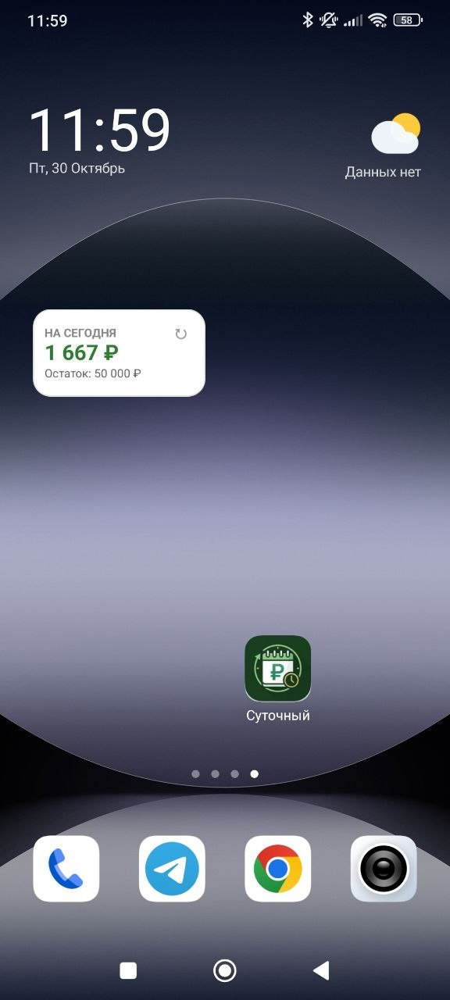
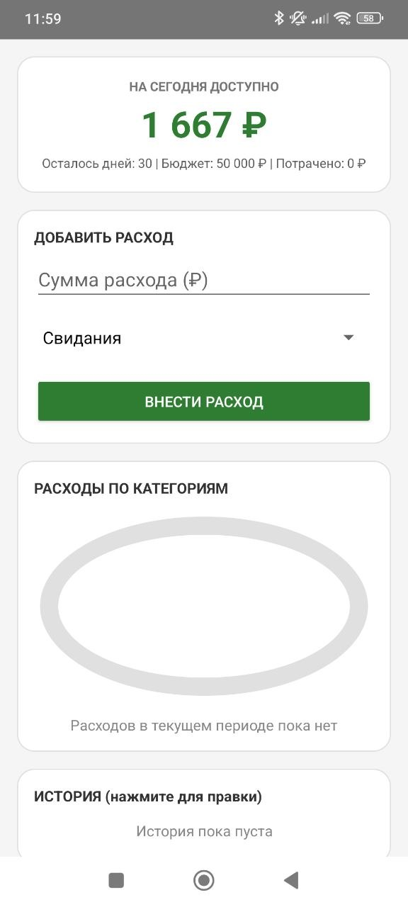
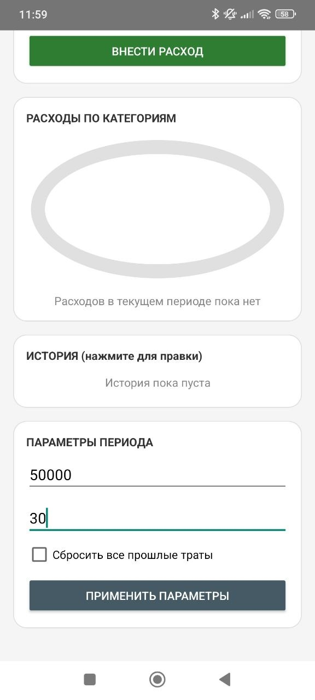
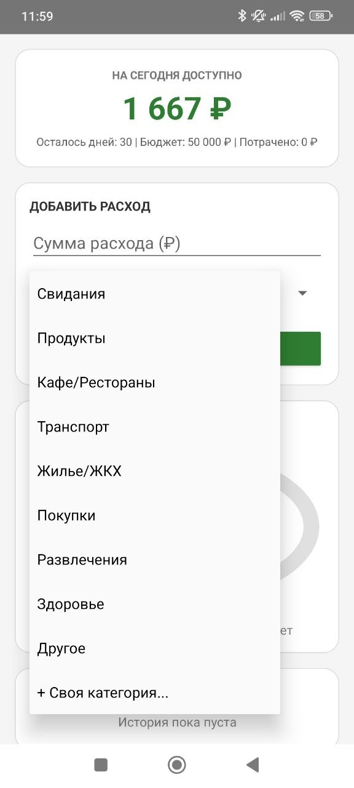
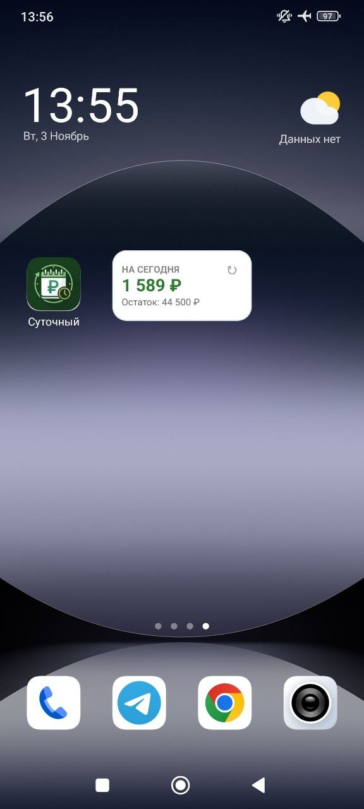
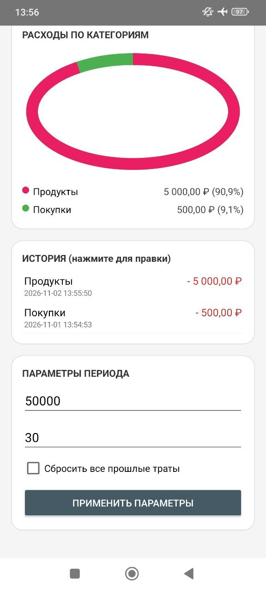

# «Суточный» — офлайн-трекер ежедневного бюджета для Android

Лаконичное и полностью автономное приложение для контроля персональных финансов. Приложение делит остаток бюджета на оставшиеся дни текущего цикла, пересчитывая суточный лимит в реальном времени.

### 📱 Интерфейс и виджет
<p align="center">
  
  
  
</p>

### 🔄 Динамика пересчёта бюджета
<p align="center">
  
  
  
  
</p>

## ✨ Ключевые особенности

- **Автономность 100%:** Приложение полностью избавлено от сетевых разрешений (в `AndroidManifest.xml` физически отсутствует `android.permission.INTERNET`). База данных хранится исключительно на вашем устройстве.
- **Плавающий суточный лимит:** Если сегодня потрачено меньше лимита — сэкономленный остаток равномерно перераспределяется на оставшиеся дни. В случае перерасхода — дефицит мягко амортизируется без стресса.
- **Интерактивный виджет на рабочий стол:** Формат 2x1 с наглядной цветовой индикацией баланса и кнопкой мгновенного обновления без открытия приложения.
- **Категории и аналитика:** Нативная кольцевая диаграмма расходов, базовый набор категорий (включая «Свидания») и возможность добавлять свои статьи.
- **Управление историей:** Фиксация точного времени трат (дата, часы, минуты) с возможностью редактирования и удаления в пару кликов.

## 📲 Установка

Скачайте готовый APK-файл в разделе [Releases](https://github.com/jacn0k/sutochniy-android/releases/tag/v1.0.0).

## 🛠 Стек технологий

- **Язык:** Kotlin
- **База данных:** SQLite (`SQLiteOpenHelper`, режим WAL)
- **Архитектура:** Чистая расчётная модель `BudgetCalculator` без сторонних SDK
- **UI:** Нативные компоненты, кастомная `View` диаграммы (`Canvas`), `AppWidgetProvider`
- **Минимальная версия:** Android 8.0 (API 26)

## 📦 Сборка из исходников

```bash
git clone [https://github.com/jacn0k/sutochniy-android.git](https://github.com/jacn0k/sutochniy-android.git)
cd sutochniy-android
./gradlew assembleDebug
```

Готовый файл: app/build/outputs/apk/debug/app-debug.apk

☕ Поддержка проекта
Приложение полностью бесплатное, не содержит рекламы и не собирает данные. Если «Суточный» помогает держать финансы под контролем — вы можете вы можете [угостить автора кофе](https://pay.cloudtips.ru/p/b7a00553)..
